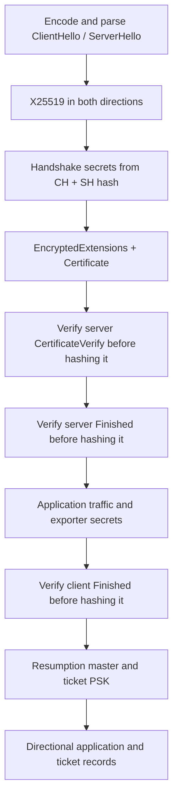

# TLS authentication foundations

The integration in
[extended_tls_auth_integration.rs](../tests/extended_tls_auth_integration.rs)
composes the existing cryptographic and wire modules into one TLS 1.3 shaped
server-authentication flight. Its profile is X25519, Ed25519, SHA-256 and
`TLS_CHACHA20_POLY1305_SHA256`, with no PSK, early data, HelloRetryRequest or
client certificate.

The retained fixture now selects `tls_hash::Algorithm::Sha256` explicitly,
passes tagged `tls_hash::Digest` checkpoints and `tls_schedule::Secret` values,
and selects the record suite through `tls_suite::Suite`. This caller migration
passed both gates on **2026-10-25** for GPU-compiled native x86_64 Linux output.
Its independent SHA-256 peer and all 40 wire fields retain their original
expectations; the profile and certificate-policy scope remain as described
above. The earlier 2026-10-24 receipt is kept below as historical evidence.
User GPU kernels and other execution targets
remain unverified. This is a test executable, not a connection API or
certificate trust validator.

## Layer contracts

| Layer | Responsibility | Caller responsibility |
| --- | --- | --- |
| [Handshake codecs](extended-tls-handshake.md) | Encode and parse framed messages and borrowed vectors | Negotiate a profile, enforce message ordering, retain backing storage |
| [X25519](extended-x25519.md) | Public shares and checked shared-secret calculation | Supply appropriate ephemeral scalar material and authenticate the exchange |
| [Transcript and schedule](extended-tls-schedule.md) | Selected-hash frame hashing, tagged schedule stages, Finished, exporters and ticket derivation | Select SHA-256 for this fixture, the correct complete-message checkpoint and directional secret |
| [DER](extended-der.md) | Canonical elements, OIDs, BIT STRINGs and borrowed traversal | Interpret certificate structures and apply X.509 validation policy |
| [Ed25519](extended-ed25519.md) | Detached signature generation and verification | Select an authenticated public key, permitted scheme and exact signed context |
| [Protected records](extended-tls-record.md) | Directional keys, sequence numbers, AEAD protection and inner framing | Install established secrets, preserve nonce authority, process higher-level state and transport |

The fixture imports and calls those modules directly. It does not replace
certificate wire data with a raw public key. The Certificate message contains
a complete, real DER X.509 certificate generated and signed by OpenSSL.



## The composed flight

The fixture writes ClientHello and ServerHello with the real codecs, then
parses their complete frames and bodies. ClientHello offers TLS 1.3, X25519,
Ed25519 and cipher suite `0x1303`; ServerHello selects that profile and echoes
the session ID. Each X25519 shared-secret calculation consumes the peer share
parsed from its Hello key-share extension. Both directional results are
compared with the independent peer.

EncryptedExtensions has an empty extension list. Certificate carries one real
certificate and no per-entry extensions. The DER reader extracts the TBS
encoding, signature algorithm, validity encodings, subject/issuer encodings,
SPKI algorithm and public-key BIT STRING, and certificate signature. It checks
that the test certificate is self-issued and verifies its raw TBS signature
with Ed25519. These are fixture anchors and primitive checks. They establish
no trust, identity, wall-clock validity, usage, constraints, chain or revocation
decision.

CertificateVerify follows
[RFC 8446, section 4.4.3](https://www.rfc-editor.org/rfc/rfc8446.html#section-4.4.3):
the signed input is 64 space bytes, the server context string, one zero byte,
and the transcript hash through Certificate. The fixture signs that exact
130-byte input, encodes signature scheme `0x0807`, then verifies the signature
using the public key parsed from the received certificate. Verification
precedes the receiver's transcript update.

Finished generation and verification follow
[RFC 8446, section 4.4.4](https://www.rfc-editor.org/rfc/rfc8446.html#section-4.4.4).
Each Finished authenticates the transcript before its own frame. The fixture
then appends that complete frame to the accepted transcript. The schedule
checkpoints are:

| Checkpoint | Derived or verified material |
| --- | --- |
| ClientHello + ServerHello | Client and server handshake traffic secrets |
| Through Certificate | Server CertificateVerify signed input |
| Through CertificateVerify | Server Finished verify data |
| Through server Finished | Client/server application traffic secrets, exporter master and 48 exported bytes; client Finished verify data |
| Through client Finished | Resumption master secret and ticket PSK |

The fixture computes the schedule once and passes those derived secrets to
its receiving routine. That routine checks received messages and record
checkpoints; it does not independently negotiate or install traffic secrets.
The Python peer independently derives and compares every emitted secret.

The server's protected handshake record contains EncryptedExtensions,
Certificate, CertificateVerify and server Finished. A separate client
handshake record carries client Finished. Application records use separate
client/server traffic secrets and sequence spaces. The server sends its
application record at application sequence zero and NewSessionTicket at
sequence one. The ticket nonce from the opened and parsed ticket is passed to
`Resumption.ticket` and checked against the sender's PSK. Ticket storage,
resumption negotiation and a subsequent connection are outside this test.

## Independent peer and test material

[peer.py](../tests/fixtures/extended/tls_auth_integration/peer.py) builds all
handshake wire bytes separately. Python `hashlib` and `hmac` implement the
transcript, HKDF labels, schedule, Finished, exporter and ticket calculations.
`libsodium.so.23`, called through `ctypes`, supplies independent X25519,
Ed25519 and IETF ChaCha20-Poly1305 operations. OpenSSL `pkeyutl` separately
verifies the certificate's raw TBS/signature using its DER SPKI. It invokes no
trust-store or wall-clock certificate acceptance.

The certificate uses the public seed from RFC 8032 test 1 and the same minimal
OpenSSL setup as the DER primitive gate. OpenSSL constructs the real version-3
certificate with serial 128, matching issuer/subject names and an explicit
BasicConstraints extension. It is generated once per driver invocation;
certificate timestamps can therefore differ between invocations. Both peers
receive the identical DER bytes from that invocation. The fixed keys, random
fields and scalar patterns are public test material.

Each case preserves **40 numbered byte fields**: both public shares and shared
secrets, complete handshake frames, every transcript checkpoint, schedule
secrets, CV input and signature, exporter bytes, ticket PSK, all five protected
records, the final accepted transcript hash, publication storage and receiver
status/sequence metadata. Comparisons use complete bytes, not only lengths or
success flags. Diagnostic stdout intentionally contains test secrets and is
not an application-data interface.

## Rejection and storage checks

The valid flight runs with both native strided arrays and packed bytes. All
arena views have nonzero offsets. Inline digest and key values remain alive
while their borrowed views are consumed. The migration checks the SHA-256 tag,
32-byte active view and every zero tail byte at indices 32 through 47 for
emitted digests and schedule secrets, Finished values, and receiver checkpoints.
Only the active 32 bytes enter wire fields or CertificateVerify input; the
48-byte backing does not change the 130-byte signed context or 32-byte
Finished framing. `view(&self)` receivers are stable local values whose inline
backing remains unchanged during each immediate read. No borrowed view escapes
a temporary digest or secret. Certificate/SPKI/frame views borrow
source or record scratch storage; that backing remains alive and unchanged
for their use. Record inputs, scratch buffers, publication storage and state
are disjoint. One authoritative state owns each sending direction; no Sealer
is copied to fork a nonce sequence.

The receiver snapshots its transcript around negative signature and Finished
checks and does not append rejected frames. Failed record authentication
preserves scratch and poisons the affected record opener without advancing
its sequence. Successful opens check the unused scratch suffix. Source
snapshots cover the Hello and authentication messages, protected records,
keys/certificate, and sender-side extension/context material; comparisons after
reception catch changes to those sources and their guards.

The fixture withholds its separate 128-byte publication buffer until all
requested authentication checks, application records and ticket processing
succeed. On success it publishes the two test application payloads and ticket
nonce; any rejection leaves the entire buffer at its sentinel value. This is
a conservative test boundary chosen to observe composition. The wire codecs
and schedule do not themselves implement a connection publication policy.

| Variant | Rejection checkpoint | Accepted transcript messages |
| --- | --- | ---: |
| 1 | CertificateVerify signature | 4 |
| 2 | Server Finished verify data | 5 |
| 3 | Client Finished verify data | 6 |
| 4 | Server handshake record authentication | 2 |
| 5 | Client handshake record authentication | 6 |
| 6 | Server application record authentication | 7 |
| 7 | Client application record authentication | 7 |
| 8 | Ticket record authentication | 7 |

The CV mutation is carried in a valid protected record, with subsequent
Finished computed over the modified CV frame. The CV check must therefore
reject it at the signature checkpoint. Finished mutations also retain valid
record authentication, separating handshake verification from AEAD checks.

## Accepted typed caller migration: 2026-10-25

The direct migration removes `tls_record::Suite`, raw secret and checkpoint
arguments, implicit transcript construction, and implicit `no_psk()`. It keeps
both layouts, the valid flight, all eight rejection variants, the independent
peer, complete field comparisons, allocation tracing and process limits. The
Rust driver changes only its profile documentation. No production module or
compatibility layer is added.

The focused target remains `extended_tls_auth_integration`, with these gates:

- `composed_tls13_authentication_flight_matches_independent_peer`: two layout
  cases and 80 complete byte fields.
- `tampered_authentication_checkpoints_reject_before_publication`: 16 layout
  cases and 640 complete byte fields.

The whole-target invocation passed both gates in **14.41 s**, covering **18
cases and 720 complete byte fields**. `OnceLock` shared one strict protocol ELF
between the two tests, which launched two native processes. Each native
allocation trace was empty for `mmap`, `munmap`, `mremap` and `brk`. Native,
certificate-generation and peer timeouts remain 30, 10 and 15 seconds. The
fresh Rust driver build took **1.17 s**. These are correctness gate timings,
not TLS or cryptographic throughput measurements.

The fixture, driver and unchanged independent peer matched these executed
source hashes:

| Source | SHA-256 |
| --- | --- |
| `tests/fixtures/extended/tls_auth_integration/flight.lani` | `63015e3144ca34f2373a52654f311f7084806dddef1e8db13bb02dd088db6638` |
| `tests/extended_tls_auth_integration.rs` | `a276f36ee06d1eecb44340a639fd5d0c274b8fe9cae456f95e8719b1a1739a5e` |
| `tests/fixtures/extended/tls_auth_integration/peer.py` | `7a94c97016e072dc8cfccc36cb55c2f4b7e277a885e78190decfb896bd84f70d` |

Ignored local evidence is in
`target/stdlib-work/tls-sha384-retained-flight-first.log` and
`target/stdlib-work/tls-sha384-retained-flight-build.log`. The build emitted
`target/stdlib-build/debug/deps/extended_tls_auth_integration-f0db9a8ba28825a5`.
An equivalent bounded rebuild from the repository root is:

```sh
timeout --kill-after=2s 100s flock -E 75 -w 35 target/stdlib-work/library-gpu.lock \
  timeout --kill-after=2s 60s env \
  CARGO_TARGET_DIR=/home/andrew-peterson/code/laniusc/target/stdlib-build \
  CARGO_INCREMENTAL=0 CARGO_PROFILE_DEV_DEBUG=0 CARGO_PROFILE_TEST_DEBUG=0 \
  cargo test --test extended_tls_auth_integration --no-run \
  > target/stdlib-work/tls-sha384-retained-flight-build.log 2>&1
```

The accepted runtime command selected the whole target without filters, with
a 90-second inner limit:

```sh
RUST_MIN_STACK=16777216 LANIUS_GPU_CODEGEN_TEST_TIMEOUT_MS=45000 \
  LANIUS_DEBUG_STAGE_ERRORS=1 timeout --kill-after=2s 100s \
  flock -E 75 -w 35 target/stdlib-work/library-gpu.lock \
  timeout --kill-after=2s 90s \
  target/stdlib-build/debug/deps/extended_tls_auth_integration-f0db9a8ba28825a5 \
  --nocapture --test-threads=1 \
  > target/stdlib-work/tls-sha384-retained-flight-first.log 2>&1
```

A fresh build may emit another executable basename. This receipt verifies the
retained SHA-256/ChaCha20-Poly1305/X25519/Ed25519 composition and its existing
rejection checkpoints.

## Historical admission: 2026-10-24

| Test | Cases | Compared byte fields |
| --- | ---: | ---: |
| `composed_tls13_authentication_flight_matches_independent_peer` | 2 | 80 |
| `tampered_authentication_checkpoints_reject_before_publication` | 16 | 640 |

The Rust driver shares one compiled protocol ELF through `OnceLock` within an
invocation. The accepted whole-target run compiled one strict ELF and launched
two native processes, with a 30-second timeout for each. OpenSSL certificate
creation and the Python peer have separate 10- and 15-second limits. Both
native processes had empty traces for `mmap`, `munmap`, `mremap` and `brk`.
There are no new Cargo crypto dependencies.

The full two-test target passed in **12.80 s**, covering **18 cases and 720
compared byte fields**. The positive gate contributed two cases and 80 fields;
the eight tamper variants in two layouts contributed 16 cases and 640 fields.
The fresh Rust build took 1.11 s and produced
`target/stdlib-build/debug/deps/extended_tls_auth_integration-f0db9a8ba28825a5`.
These timings record correctness admission, not TLS or crypto throughput.

The accepted fixture's SHA-256 is
`e1976208f2fede75e10d6d7266d25f6207f5aff5d23b138de7a7b81953cf7c2b`.
Local ignored evidence is under `target/stdlib-work/tls-auth-admission/`:
`auth-integration-all.log` records the two-test pass, and
`build-auth-integration.log` records the Rust build. These artifacts are not
checked in.

The accepted command, run from the repository root, was:

```sh
timeout --kill-after=2s 100s flock -E 75 -w 35 target/stdlib-work/library-gpu.lock \
  timeout --kill-after=2s 60s env \
  RUST_MIN_STACK=16777216 LANIUS_GPU_CODEGEN_TEST_TIMEOUT_MS=45000 \
  LANIUS_DEBUG_STAGE_ERRORS=1 \
  target/stdlib-build/debug/deps/extended_tls_auth_integration-f0db9a8ba28825a5 \
  --nocapture --test-threads=1
```

A fresh build may produce another executable basename.

## Requirements for a full TLS connection

A connection layer still needs incremental transport I/O and plaintext-record
framing, handshake fragmentation/reassembly, negotiated extension and algorithm
policy, the full client/server state machine, alert and closure handling,
traffic-secret installation rules, KeyUpdate processing, certificate path and
identity validation, operational key/random/nonce management, resource and
message budgets, and ticket/PSK lifetime and replay policy. Additional profiles
such as client authentication, HRR and early data need their own sequencing
and policy. The composed flight neither implements nor claims those behaviors.
